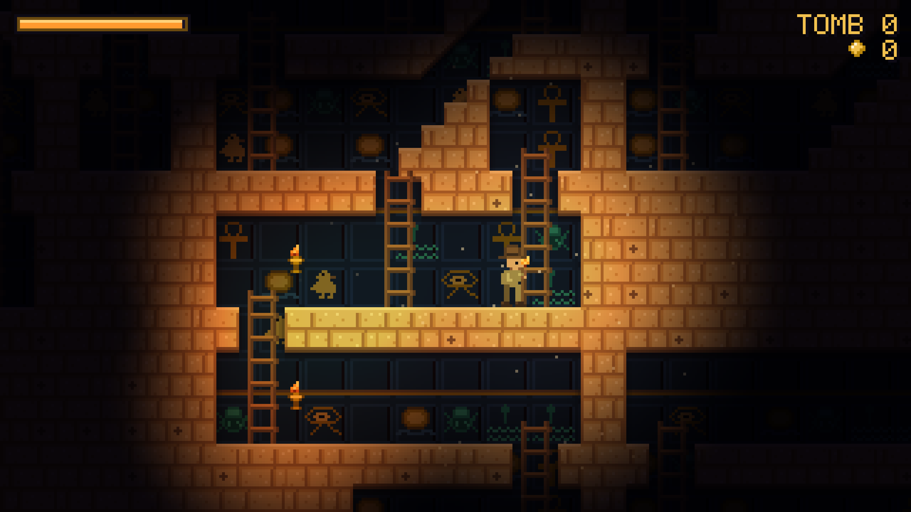
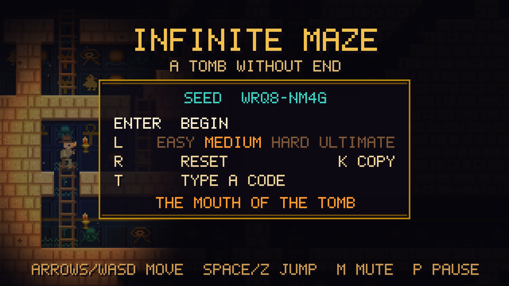

# Infinite Maze



An endless tomb maze, climbed by torchlight. One seed code grows a plane of
tombs without end in any direction. The difficulty picked on the title sets a
tomb's size: EASY 2x2 boards, MEDIUM 3x3, HARD 4x4 and ULTIMATE 6x4, the
original world. Every board is a 12x7 grid of cells, and the level also sets
how much of each room is carved, about half at EASY and 60% at HARD and
ULTIMATE; the rest is rock.
Each tomb leaves up, left or right, never down, so the way on wanders sideways
as it climbs, and the maze has no loops at any scale. Every difficulty is the
same open plane: the tombs and their doors are the same at every level, and
only the boards inside a tomb differ.
`docs/SPEC.md` is the full specification.

## Play



Open `infinite-maze.html` in a browser. It is one file with no network access
and no assets.

- **Arrows or WASD** move. Left and right run the corridors. Up or down takes
  the cell's ladder or gallery stair from anywhere on its floor; holding the
  side away from a stair keeps the explorer on the floor. A stair is also
  taken by running into it, and an Up or Down tapped just before a cell counts
  on arrival. On a ladder, a Left or Right press climbs off at its nearer end.
- **Space or Z** jumps. In the air, Up grabs the ladder overhead or the stair
  below, and a jump onto a stair lands on it. On a ladder, a jump lets go and
  drops to the floor below; a held Up grabs again once pressed anew.
- **P** pauses and shows `TOMB n`, the map of the passages walked and the
  save code; P resumes. Esc does the same outside full screen, where a browser
  keeps Esc for itself. The arrows (or WASD) pan the map one tomb per press.
  **C** there copies the save code, and an unsaved run's **Enter** saves it
  while a slot can take a save. **M** mutes.
- **Touch.** On a phone the view fills the screen. A d-pad moves: its arms
  run, climb and descend, and a red fire button opposite it jumps. Soft keys
  cover every screen: RESUME, BEGIN, RESET, LOAD, the difficulty, COPY, SOUND
  and PAD (swaps the d-pad and the fire button) on the title; SLOT 1 to SLOT
  3, TYPE CODE (a prompt that takes a pasted save code) and BACK on LOAD; SLOT
  1 to SLOT 3 and BACK on the overwrite pick; one SLOT key per row on SAVE IN?;
  SAVE, COPY and SOUND on pause; PAUSE, CONTINUE, HOME, TITLE and, to answer a
  confirm, YES and NO. Pressing a key
  switches back to the keyboard layout; `#touch` on the URL forces touch on a
  desktop. The pause map shows the explorer's tomb; panning needs a keyboard
  or controller.
- **Controller.** A standard-mapped gamepad plays with no setup: press a
  button so the browser sees it. The d-pad or left stick moves, pans the pause
  map and moves the cursors of the title, LOAD, the overwrite pick and SAVE IN?,
  Left and Right stepping the title's difficulty; **A** jumps and begins on the
  title; **B** selects, answers yes to a confirm and continues past the
  milestone splash; **Start** pauses and resumes; **Select** goes to the title,
  backs out of LOAD, the pick, SAVE IN? and code entry, and answers no to a
  confirm.
- The torch burns for 300 s, and its light shrinks as it burns. Touch a
  turquoise brazier to relight it. At zero it gutters to an ember for 10 s;
  reach a flame in that time or the run ends. Every room holds oil jars on
  dead ends with no coin: two a room at EASY and one at MEDIUM, HARD and
  ULTIMATE. A room holds 4.7, 6.4, 6.6 and 6.6 dead ends by level, and 5.9%,
  5.0%, 5.0% and 4.8% of them hold a coin, measured. Touch a jar to add 60 s
  of burn, up to a full torch, or to relight an ember. A jar taken in the tomb
  you are in or the tomb before it stays taken, through a reload and Continue;
  older tombs' jars lie back.
- Occasional hints mark the way on at a junction with a real choice; a link
  into a one-room dead end is none. A carved arrow in the upper corner of the
  room points along the link: about 1 junction in 12 at EASY, 1 in 16 at
  MEDIUM, 1 in 24 at HARD and 1 in 32 at ULTIMATE. A skeleton slumped in a
  lower corner points with its arm, at about one per tomb. A second set, about
  as many again, shows only while the torch burns under half, fading in between
  150 s and 140 s; a flame or a jar that lifts the torch to half or above hides
  it. A junction holds at most one pointer, and all are always on.
- No board burns for being a tomb entry. Braziers stand where chance and the
  gap rule put them: a route's first board is a flame candidate one time in
  three, and every third board after it is a candidate for certain. A
  candidate within 20 s' walk of a flame its tomb has kept is dropped, so a
  candidate can stay dark; gap flames are exempt. No stretch of a way on runs
  more than 150 s between flames, across tomb walls too.
- Coins lie on the floors of dead ends, about one dead end in twenty, and in
  rows of three on about one corridor in 25, the way on included: about ten
  times the coins of dead ends alone. Touch one to take it. Coins and jars
  taken in the tomb you are in and the tomb before it stay taken, through a
  reload and Continue; older tombs' lie back, and BEGIN lays every one back.
  Each rise of a save's `TOMB n` pays once: 1 coin a tomb at EASY, 2 at
  MEDIUM, 5 at HARD and 10 at ULTIMATE. A walk back and forward pays nothing.
  The wallet shows under `TOMB n`; the end screen shows the coins earned this
  run. Each of three saves keeps its own wallet beside its serial, difficulty,
  start tomb, count and high, continue count, the takes of the last two tombs
  and the time it was last played, as one record in `localStorage`, and every
  write merges with the stored record, so two tabs on one save lose nothing.
  Every new run starts with no coins at `TOMB 0`. Nothing buys with coins yet.
- In some dead ends, more often the longer ones, the dust drifts back toward the
  way in while the explorer stands inside, a hint that the branch leads
  nowhere.
- Every 100 tombs a splash names an adventure rank and pays 100 × k coins once
  per save; **Enter** or CONTINUE plays on, and **Q** or HOME goes to the title
  with the run open.
- The score counts tombs by net position: leaving a tomb through its exit
  door adds one, any other crossing into another tomb takes one away, and
  `TOMB n` shows the highest the run has reached. A walk back and forward adds
  nothing, and no reload of a save made a step back raises it. Continue, and a
  load, keep the count and the start tomb. Each Continue after the torch dies
  adds one to the run's continue count, shown on the pause and end screens;
  pausing and resuming never add, and BEGIN starts at 0.

The title shows the seed: **Enter** or **Space** begins at tomb (0, 0)'s
first entry, **R** rolls a new seed, **K** copies it, **L** cycles the
difficulty, Left and Right stepping it, and **T** opens LOAD; Up and Down move
the cursor between BEGIN and LOAD. A new run saves itself and play never stops
for a slot: its first coin or counted tomb takes the lowest empty of three
slots and says `SAVED IN SLOT n` for two seconds. With all three slots full,
BEGIN first asks which one to overwrite, OVERWRITE SLOT n? confirms, and the
old save stays whole until the new run's first coin or counted tomb. LOAD
lists the three saves, each with its level, `TOMB n`, coins and the time since
it was played: **Enter** or **1** to **3** load one at once at its own
difficulty, the open run's own row resumes it, and `T TYPE A CODE` takes a
typed seed or save code; a slot's own serial loads that slot. Beginning or
loading over a run that holds coins or tombs but no save asks LEAVE UNSAVED
RUN? first. A run left without a slot, as when another tab took its slot with
all three full, says `NOT SAVED: PAUSE TO SAVE`, and its pause's **Enter**
opens SAVE IN?. **P** resumes the run left by pause; Esc is P's alias outside
full screen. The pause and end screens' **C** copies the save code. The game
keeps the three saves, the setting and the best per seed and difficulty in
`localStorage`, and runs without them where storage is blocked, the title
reading `SAVES OFF: COPY YOUR CODE`. A save from before the slots moves to
slot 1 once, wallet included; the old copy stays for an older build.

## Save codes

A save is the seed code and one integer: `K7Q2-M9XA:4813`. The integer pairs
the signed coordinates of board `(x, y)`: with `z(n) = 2n` for `n >= 0`, else
`-2n - 1`, `a = z(x)` and `b = z(y)`, `p = a >= b ? a*a + a + b : a + b*b`.
Saves hold `|x|` and `|y|` below 2^25, and a code runs to 26 characters. A
typed save code plays at the title's difficulty, and a slot's own serial at its
save's.
Resuming regenerates that board from the seed and lights the torch to full.
The explorer stands at the start of the board's way back along its route.
The end screen offers the code of the last tomb entry reached; Continue
resumes there.

## Build

```sh
node tools/build.mjs           # writes infinite-maze.html from src/
node tools/build.mjs --check   # fails when infinite-maze.html is stale
```

Tested with node 26. No dependencies.

## Gates

```sh
node tools/build.mjs --check
node --test test/
node tools/acceptance.mjs
"$CHROME" --headless=new --disable-gpu --virtual-time-budget=30000 \
  --dump-dom "file://$WT/infinite-maze.html#selftest" | grep -q 'data-selftest="pass"'
! grep -Eiq '(src|href)=["'\'']?https?:|fetch\(|XMLHttpRequest|WebSocket' infinite-maze.html
```

`AGENTS.md` defines `WT` and `CHROME`. The acceptance harness checks tombs
`u` -10 to 10 by `v` -50 to 50 (`--cols` and `--rows` set the half-widths) at
each difficulty and prints, per difficulty, the fallback-board count, the
largest and 99th percentile flame gaps and the shares of up, left and right
exits with the mean sideways run. Way up, run once at ULTIMATE, checks that
every tomb's way on climbs out of the window within 100,000 steps and reports
how many ways on meet tomb (0, 0)'s. The harness ends with its run time.
`infinite-maze.html#selftest` boots seed `0000-0000`, drives 5100 ticks of
scripted input and draws the pause map. A second leg resumes at MEDIUM in
tomb (1, 0), outside board columns 0-2, and fails unless the explorer's room
draws as maze rather than rock. The self-test then sets `data-selftest` on
`<body>`.

## Deploy

Every push to main deploys. `.github/workflows/ci-cd.yml` runs the gates,
then, for `main` only, deploys `StackMaze2adCom`, uploads `infinite-maze.html`
as `index.html` with `aws s3 sync --delete`, so the bucket holds the release
alone, and invalidates CloudFront. Pull requests run the gates alone,
with no AWS credentials. The game is served at https://maze.2ad.com from a
private S3 bucket behind CloudFront. `cdk/` defines the bucket, certificate,
distribution and DNS records in the shared `2ad.com` zone, which the stack
imports read-only.

A trial build for a phone play-test goes to `beta/<name>.html` in the bucket
and is served at `https://maze.2ad.com/beta/<name>.html` until the next deploy
removes it. It shares the live game's origin, and with it the three saves and
the bests in local storage. Copy it uncached, so a re-copy under the same name
serves at once:

```sh
aws s3 cp trial.html s3://maze-us-east-1-504242000181/beta/<name>.html \
  --cache-control "no-cache, no-store, must-revalidate" \
  --content-type "text/html; charset=utf-8"
```

The workflow signs in through OIDC as `GithubDeployCI`. One-time setup outside
this repo: the role must trust
`repo:jac18281828@11556011/infinite-maze@1413247652:ref:refs/heads/main` and
carry an `AllowMazeDeploymentS3` policy like its `AllowSolitareDeploymentS3`.

### By hand

```sh
export AWS_PROFILE=awsapproach
bun install --frozen-lockfile
bun run test
bun run cdk:deploy -- StackMaze2adCom --require-approval never
site="$(mktemp -d)" && cp infinite-maze.html "$site/index.html" &&
  aws s3 sync "$site/" s3://maze-us-east-1-504242000181/ --delete \
  --cache-control "no-cache, no-store, must-revalidate" \
  --content-type "text/html; charset=utf-8"
aws cloudfront create-invalidation --paths "/*" \
  --distribution-id "$(aws cloudformation describe-stacks --stack-name StackMaze2adCom \
    --query "Stacks[0].Outputs[?OutputKey=='DistributionId'].OutputValue" --output text)"
```

## License

BSD 3-Clause; see [LICENSE](LICENSE).
